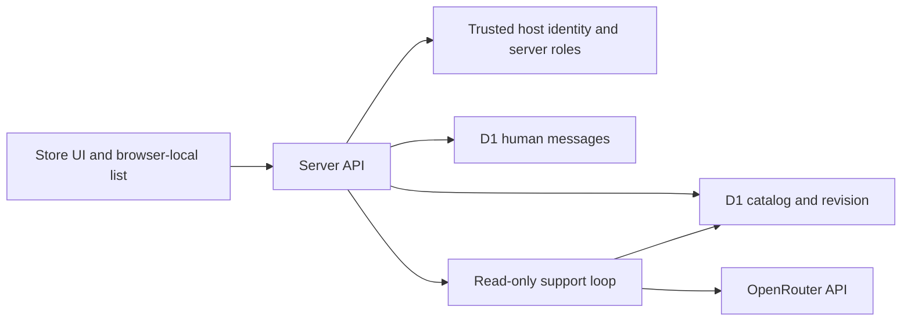

# Architecture / 架构

- `public/store/`: static store UI, loadout-list arithmetic, admin panels, AI and human-support panels.
- `app/api/`: authenticated HTTP endpoints. Staff write operations are separate from model tools.
- `lib/catalog-db.ts`: one revision-controlled JSON catalog in D1.
- `lib/support-agent.mjs`: two-tool support loop with bounded calls. Tool execution is read-only; final free-text fact verification remains incomplete.
- `lib/model-routing.mjs`: allowed model IDs and role-dependent manual/rule-based routing.
- `lib/human-support.ts`: customer-owned threads and staff replies.
- `app/chatgpt-auth.ts` and `build/sites-vite-plugin.ts`: trusted-host identity and local development sign-in integration.
- `drizzle/`: ordered migrations. Existing data is not replaced when a migration runs.

## Trust and portability

The identity headers are meaningful only behind a trusted host that verifies users and strips incoming spoofed values. Generic independent deployment requires a real session adapter or a trusted verifying gateway. Local sign-in is restricted to loopback development. Neither the repository nor an API key alone supplies production authentication.

The project uses vinext/Vite and Cloudflare Workers/D1. It is not a static-only application or a ready-made production deployment template. The generic binding manifest contains no original deployed Site ID. Configure your own runtime and database before independent deployment.

## State

Catalogs, roles, model settings and human messages are server-side. The loadout list is browser-local. AI conversation history is held in page memory. Model keys are server environment secrets, not database model IDs or client-side settings.

## 中文

前端与客服共用服务端目录；后台写接口独立于 AI 只读工具。数据库保存目录、版本号、角色和人工留言；配装清单在浏览器保存，对话历史只在页面内存中保存。当前未实现自动配装求解、完整事实核验、生产限流和费用熔断。公网迁移必须先适配可信认证。
